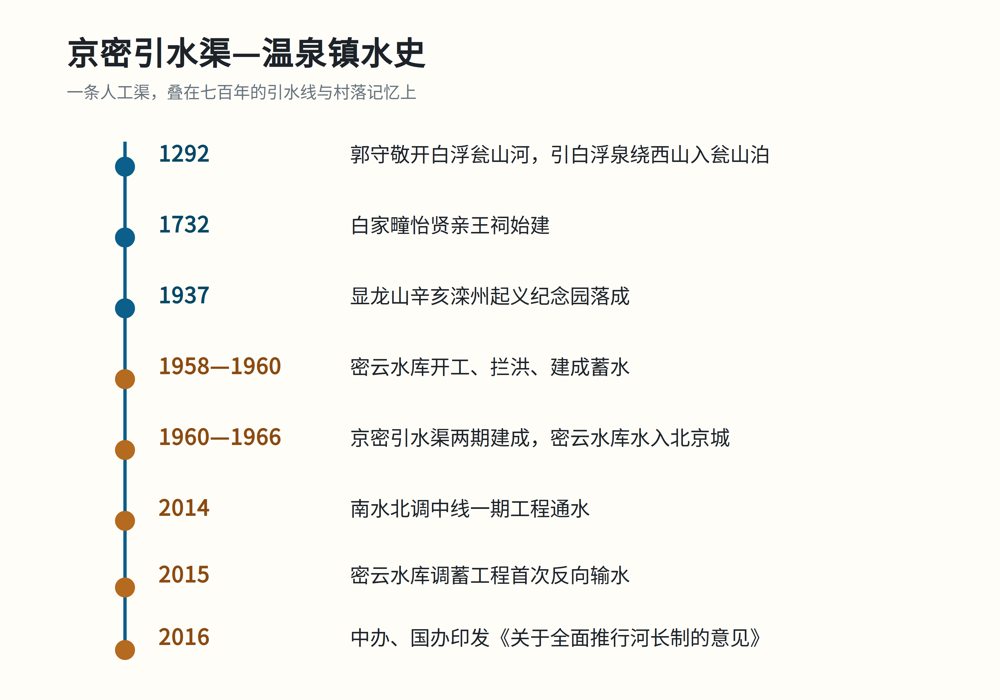

# 一条渠的三层时间

> **一句话结论**：京密引水渠是 1960 年代修成的人工渠，却大体走在 700 年前元代白浮瓮山河的附近；它穿过温泉镇时，又把明清村落、民国纪念地和当代河长制串在了同一条水线上。

## 问题的提出

温泉镇的河长公示牌上写着“京密引水渠（沙河）流域”。一条人工渠为什么会被放进“沙河流域”？它和元代郭守敬的引水线是什么关系？这篇最小示例只回答一个问题：**这条渠在温泉镇一带，叠着哪几层时间？**

## 时间轴

*图源：[北京市水务局](https://swj.beijing.gov.cn/swdt/swyw/202606/t20260610_4693988.html) · 作者据该报道及地方志绘制*

| 时间 | 事件 | 依据 |
|---|---|---|
| 1292 | 郭守敬开白浮瓮山河 | [《郭守敬修筑白浮瓮山河》](http://epaper.gmw.cn/wzb/html/2025-07/30/nw.D110000wzb_20250730_2-05.htm) |
| 1732 | 白家疃怡贤亲王祠始建 | [海淀文物长廊](https://zyk.bjhd.gov.cn/kjhd/whhd/hdww/wwcl/202208/t20220801_4545961.shtml) |
| 1937 | 辛亥滦州起义纪念园落成 | [北京市文物局](https://wwj.beijing.gov.cn/bjww/362771/362779/dlpqgzdwwbhdw/523481/index.html) |
| 1958—1960 | 密云水库开工、建成 | [中国水利报](http://www.chinawater.com.cn/newscenter/ly/haih/202009/t20200903_755798.html) |
| 1960—1966 | 京密引水渠两期建成 | [人民日报](https://swj.beijing.gov.cn/swdt/swyw/202606/t20260610_4693988.html) |
| 2014 | 南水北调中线一期工程通水 | [人民日报](https://swj.beijing.gov.cn/swdt/swyw/202606/t20260610_4693988.html) |
| 2015 | 密云水库调蓄工程首次反向输水，南水经京密引水渠入密云水库 | [中国网](http://www.china.org.cn/bjzt/chinese/2015-11/24/content_37143845.htm) |
| 2016 | 中办、国办印发《关于全面推行河长制的意见》 | [人民网](http://politics.people.com.cn/n1/2016/1211/c1001-28940545.html) |

## 一、渠：新渠走老线

京密引水渠 1961 年一期建成，1966 年二期通水，全长 110 余公里，从密云水库经怀柔水库入团城湖。它常被说成“沿元代白浮瓮山河故道”。公开报道称，现代京密引水渠白浮村至昆明湖段“大体走向也基本与元代故道一致”；但这只是走向判断，不等于全线压故道，具体线位仍需学术考证。([人民日报](https://swj.beijing.gov.cn/swdt/swyw/202606/t20260610_4693988.html)；[文摘报](http://epaper.gmw.cn/wzb/html/2025-07/30/nw.D110000wzb_20250730_2-05.htm))

## 二、镇：泉、祠、码头

白家疃有始建于雍正十年（1732）的怡贤亲王祠；太舟坞有黑龙潭及龙王庙，据当地记述因元代白浮瓮山河码头得名。([海淀文物长廊](https://zyk.bjhd.gov.cn/kjhd/whhd/hdww/wwcl/202208/t20220801_4545961.shtml)；[北京市政府](https://www.beijing.gov.cn/fuwu/bmfw/sy/jrts/202609/t20260910_4857775.html)；[海淀区文旅局](https://zyk.bjhd.gov.cn/sjkf/zxsj/202308/t20230831_4625042.shtml))

## 信史、争议与传说

- **较可靠**：密云水库与京密引水渠的时间线、辛亥滦州起义纪念园、怡贤亲王祠。
- **需要限定**：“沿故道”只在“大体走向”的意义上成立；具体线位仍需学术考证。
- **地方记忆/争议**：曹雪芹徙居白家疃属于地方记忆或红学争议，需与志书、文物名录分开看。([新浪新闻](https://news.sina.com.cn/c/2013-11-11/033028673420.shtml))

## 参考资料

1. [运行60年，这条渠更年轻](https://swj.beijing.gov.cn/swdt/swyw/202606/t20260610_4693988.html) — 人民日报，2026-06-10。
2. [郭守敬修筑白浮瓮山河](http://epaper.gmw.cn/wzb/html/2025-07/30/nw.D110000wzb_20250730_2-05.htm) — 文摘报，2025-07-30。
3. [怡贤亲王祠](https://zyk.bjhd.gov.cn/kjhd/whhd/hdww/wwcl/202208/t20220801_4545961.shtml) — 海淀区文旅局，2020-01-25。
4. [御碑守望古莲池](https://www.beijing.gov.cn/fuwu/bmfw/sy/jrts/202609/t20260910_4857775.html) — 北京市政府，2026-09-10。
5. [贤王祠与曹雪芹小道](https://news.sina.com.cn/c/2013-11-11/033028673420.shtml) — 北京日报/新浪，2013-11-11。
6. [密云水库：新中国水利史上的一座丰碑](http://www.chinawater.com.cn/newscenter/ly/haih/202009/t20200903_755798.html) — 中国水利报，2020-09-03。
7. [中办国办印发《关于全面推行河长制的意见》](http://politics.people.com.cn/n1/2016/1211/c1001-28940545.html) — 人民网，2016-12-11。
8. [2023年度海淀区文物保护单位名录](https://zyk.bjhd.gov.cn/sjkf/zxsj/202308/t20230831_4625042.shtml) — 海淀区文旅局。
